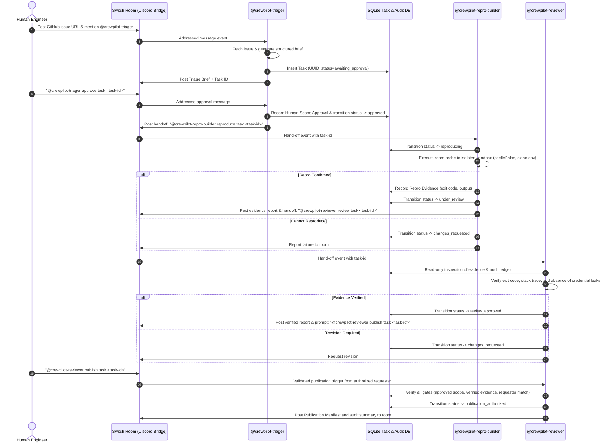

# CrewPilot Architecture & Squad Workflow Specification

**Status:** Implemented & Verified Architecture Specification
**Date:** 2026-11-06
**Project:** CrewPilot — Evidence-Driven Bug Investigation Squad
**Track:** Flip the Switch Hackathon — Best Business Workflow

---

## 1. Executive Overview & Design Principles

CrewPilot bridges the chasm between messy, ambiguous bug reports in team chat and auditable, tested code changes on GitHub. The system coordinates human engineers and autonomous agents through **Switch** as the central collaboration bus.

### Core Architecture Axioms:
1. **Switch is Essential, Not Decorative:** All agent-to-human and agent-to-agent communication passes through Switch rooms and addressed messages. Removing Switch stops the collaboration workflow entirely.
2. **Documented SSE/HTTP Transport:** The squad operates over the official Switch agent protocol (`sandbox-quantum/switch`): SSE stream down (`GET /agents/{id}/events`) and authenticated HTTP operations up (`POST /agents/{id}/ops/{op}`). No WebSockets are used.
3. **Genuinely Independent Personas:** Rather than a single monolithic prompt masquerading as multiple roles, CrewPilot operates three distinct agents with separate Switch credentials, distinct execution lifecycles, and isolated security boundaries.
4. **Evidence-Driven State Transitions:** No code change advances without deterministic proof (exit code 1 for bug reproduction, exit code 0 for tests, recorded command stdout/stderr).
5. **Zero-Trust Input & Least-Privilege Execution:** Bug reports and generated code are untrusted. Code execution happens in isolated worktrees without access to system tokens or private environments.

---

## 2. Squad Architecture: Three Independent Switch Agents

CrewPilot operates as a three-agent squad collaborating across Switch rooms backed by durable SQLite state:



---

## 3. Distinct Agent Roles & Trust Boundaries

| Agent Identity | Switch Permissions | Local Capabilities | Secrets Access | Network Access |
| :--- | :--- | :--- | :--- | :--- |
| **`crewpilot-triager`** | Public room messaging, read context | Issue parsing, LLM completion, task initialization in SQLite | LLM API key, Switch credentials | GitHub Issue API (Read-only), LLM provider |
| **`crewpilot-repro-builder`** | Room messaging, targeted messaging to Triager/Reviewer | Credential-reduced disposable workspace execution, subprocess runner (`shell=False`) | **Zero secrets.** No GitHub token, no Switch API key in workspace | Stripped environment; no outbound secrets |
| **`crewpilot-reviewer`** | Room messaging, targeted messaging to Builder | Read-only evidence inspection, policy & security check | Switch credentials only (No LLM key required) | Internal SQLite state reading |
| **`Publication Authorizer`** | Authorized by Reviewer on maintainer command | Publication manifest creation, audit finalization | No remote GitHub write tokens in default mode | Local manifest & audit finalization |

---

## 4. SQLite TaskStore & Audit Schema

Implemented in `storage/task_store.py` with standard-library `sqlite3`:

- **`tasks`**: Tracks `task_id` (UUID PK), `room_id`, `thread_id`, `requester_id`, `requester_name`, `issue_source`, `request_key`, `status`, `created_at`, `updated_at`.
- **`task_revisions`**: Versions of triage plans and fix strategies.
- **`task_evidence`**: Durable artifacts with `command`, `output`, `artifact_path`, `commit_sha`, `created_at`.
- **`task_approvals`**: Multi-factor human authorizations binding `actor_id`, `decision`, `feedback`.
- **`task_audit`**: Immutable append-only audit trail capturing all lifecycle events (`TASK_CREATED`, `DECISION_RECORDED`, `STATUS_CHANGED`, `EVIDENCE_ADDED`).

### State Machine Transitions
```text
awaiting_approval -> approved | changes_requested | cancelled
changes_requested -> awaiting_approval | cancelled
approved          -> reproducing | cancelled
reproducing       -> under_review | changes_requested | cancelled
under_review      -> review_approved | changes_requested | cancelled
review_approved   -> publication_authorized | cancelled
```

---

## 5. Security & Isolation Invariants

1. **Subprocess Isolation:** The Reproducer runs strictly through explicit argument vectors (`subprocess.run([sys.executable, probe_path], shell=False)`). No interpolated shell strings are ever executed.
2. **Environment Sanitization & Credential Reduction:** Subprocesses inherit a sanitized environment blocklist stripping all variables matching `KEY`, `TOKEN`, `SECRET`, `PASSWORD`, `AUTH`, `CREDENTIAL`, etc.
3. **Execution Containment Boundary & Limitations:**
   - Probes execute in a dedicated, disposable temporary directory (`tempfile.mkdtemp(prefix="crewpilot-task-")`), and probe scripts/evidence are persisted to `.evidence/task-<id>/`.
   - **Current Limitation:** Subprocesses run with the local user's OS permissions without container-level kernel namespaces, cgroups, or network sandboxing (e.g., Docker, Bubblewrap, or gVisor). Untrusted code could inspect accessible host filesystem paths. Full containerization is a documented production roadmap milestone.
4. **No Credential Leakage:** Reviewer performs automated audit pattern scanning (`SECRET_LEAK_RE`) over all captured evidence before approving.
5. **No False Remote Mutations:** To prevent unauthorized Git repository pollution, automated squad execution concludes with a verified local Publication Manifest (`publication_authorized`) in durable SQLite. Automated remote PR creation is fail-safe disabled.
6. **Exact Human Authorization:** Only the original requester (`task.requester_id`) can approve triage or authorize publication manifest preparation. Room-level fallbacks are strictly prohibited.
