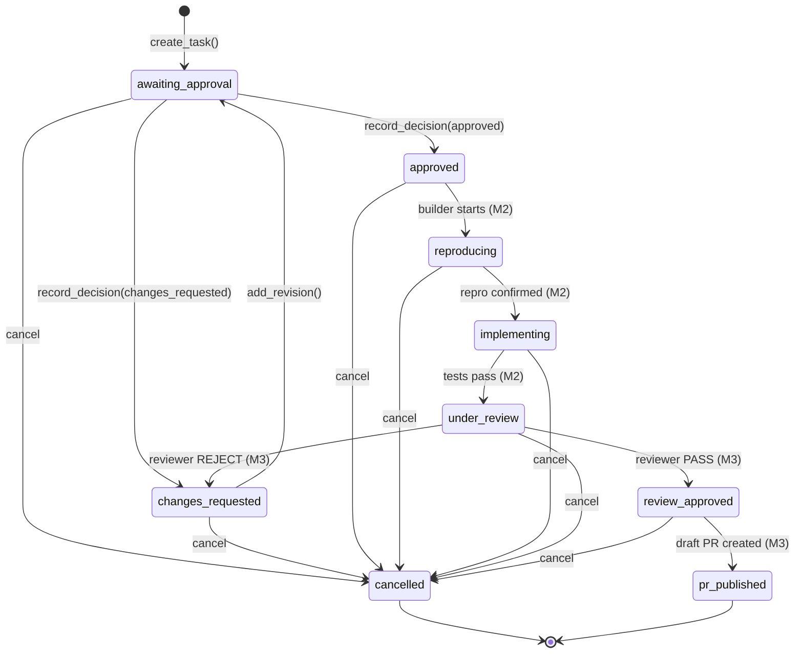

# CrewPilot Durable SQLite Task Store Specification

**Status:** Implemented Pre-Event Infrastructure (M0 Deliverable)  
**Date:** 2026-11-01  
**Module:** `storage/task_store.py`  
**Test Suite:** `tests/test_task_store.py` (18 unit tests, 100% pass)  

---

## 1. Overview & Architecture Principles

The CrewPilot SQLite Task Store provides persistent, transactional, and auditable storage for tasks, revisions, verification evidence, and human approval decisions.

### Core Architecture Axioms:
1. **Zero External Dependencies:** Implemented exclusively using Python's standard-library `sqlite3`.
2. **Deterministic Multi-Factor Approval Binding:** Approval decisions require exact `task_id`, exact `room_id`, exact `thread_id` (with strict null checking), and exact requester identity. Room-level fallback and cross-thread inference are eliminated.
3. **Atomic State Transitions:** State changes, evidence attachments, and approvals are executed inside `BEGIN IMMEDIATE` transactions to prevent race conditions.
4. **Immutable Audit History:** State mutations automatically append structured audit records; history is never overwritten or deleted.
5. **No Secrets in Persistence:** API keys, GitHub tokens, and sensitive credentials are never stored in the database.

---

## 2. Database Schema & Data Definition (DDL)

```sql
CREATE TABLE IF NOT EXISTS tasks (
    task_id TEXT PRIMARY KEY,
    room_id TEXT NOT NULL,
    thread_id TEXT,
    requester_id TEXT NOT NULL,
    requester_name TEXT NOT NULL,
    issue_source TEXT NOT NULL,
    request_key TEXT NOT NULL,
    status TEXT NOT NULL,
    created_at TEXT NOT NULL,
    updated_at TEXT NOT NULL
);

CREATE TABLE IF NOT EXISTS task_revisions (
    revision_id TEXT PRIMARY KEY,
    task_id TEXT NOT NULL REFERENCES tasks(task_id) ON DELETE CASCADE,
    revision_number INTEGER NOT NULL,
    triage_summary TEXT NOT NULL,
    triage_data_json TEXT NOT NULL,
    created_at TEXT NOT NULL,
    CONSTRAINT uq_task_revision UNIQUE(task_id, revision_number)
);

CREATE TABLE IF NOT EXISTS task_evidence (
    evidence_id TEXT PRIMARY KEY,
    task_id TEXT NOT NULL REFERENCES tasks(task_id) ON DELETE CASCADE,
    evidence_type TEXT NOT NULL,
    description TEXT NOT NULL,
    command TEXT,
    output TEXT,
    artifact_path TEXT,
    commit_sha TEXT,
    created_at TEXT NOT NULL
);

CREATE TABLE IF NOT EXISTS task_approvals (
    approval_id TEXT PRIMARY KEY,
    task_id TEXT NOT NULL REFERENCES tasks(task_id) ON DELETE CASCADE,
    actor_id TEXT NOT NULL,
    decision TEXT NOT NULL,
    feedback TEXT,
    approved_scope TEXT,
    created_at TEXT NOT NULL
);

CREATE TABLE IF NOT EXISTS task_audit (
    audit_id TEXT PRIMARY KEY,
    task_id TEXT NOT NULL REFERENCES tasks(task_id) ON DELETE CASCADE,
    actor_id TEXT NOT NULL,
    event_type TEXT NOT NULL,
    event_data_json TEXT NOT NULL,
    created_at TEXT NOT NULL
);

-- Indexes for performance & query isolation:
CREATE INDEX IF NOT EXISTS idx_tasks_room_thread ON tasks(room_id, thread_id);
CREATE INDEX IF NOT EXISTS idx_tasks_request_key ON tasks(request_key);
CREATE INDEX IF NOT EXISTS idx_tasks_status ON tasks(status);
CREATE INDEX IF NOT EXISTS idx_task_revisions_task ON task_revisions(task_id);
CREATE INDEX IF NOT EXISTS idx_task_evidence_task ON task_evidence(task_id);
CREATE INDEX IF NOT EXISTS idx_task_approvals_task ON task_approvals(task_id);
CREATE INDEX IF NOT EXISTS idx_task_audit_task ON task_audit(task_id);
```

---

## 3. Task Lifecycle & State Transitions

Tasks follow a deterministic Finite State Machine (FSM).



### Transition Validation Rules:
- A task can only receive a human scope decision when its status is **`awaiting_approval`**.
- Once a decision is recorded (`approved` or `changes_requested`), subsequent attempts to re-decide raise `TaskStateError`.
- Illegal jumps (e.g. from `awaiting_approval` directly to `pr_published`) are rejected with `TaskStateError`.

---

## 4. Strict Approval Safety Guarantees

The baseline Auto-Triager contained a documented P0 defect (`_find_pending` falling back to the room's most recent task across mismatched threads).

`TaskStore.record_decision()` completely eliminates this vulnerability by enforcing **multi-factor validation**:

```python
def record_decision(
    self,
    *,
    task_id: str,
    room_id: str,
    thread_id: str | None,
    actor_id: str,
    decision: str,
    feedback: str | None = None,
    approved_scope: str | None = None,
) -> TaskApproval:
```

### Authorization Gate Checks:
1. **Task Existence:** Rejects with `TaskNotFoundError` if `task_id` is unknown.
2. **Exact Room Match:** Rejects with `TaskRoomMismatchError` if `incoming_room != task.room_id`.
3. **Exact Thread Match:**
   - If task has `thread_id=None`, decision must supply `thread_id=None`.
   - If task has `thread_id="t-1"`, decision must supply `thread_id="t-1"`.
   - Mismatches reject with `TaskThreadMismatchError`.
4. **Requester Authorization:** Rejects with `UnauthorizedActorError` if `actor_id != task.requester_id`.
5. **State Gate:** Rejects with `TaskStateError` if task status is not `awaiting_approval`.
6. **Decision Validation:** Rejects with `InvalidDecisionError` if decision is not `"approved"` or `"changes_requested"`.

---

## 5. Transaction Boundaries & Connection Lifecycle

- **Short-Lived Connections:** Each method call obtains a connection via `_connection()` context manager and closes it immediately upon completion, preventing connection leaks or file locks on Windows.
- **Immediate Write Locks:** Write transactions execute `BEGIN IMMEDIATE;` to serialize writes and eliminate race conditions between concurrent approval requests.
- **Foreign Keys Enabled:** Every SQLite connection executes `PRAGMA foreign_keys = ON;` and `PRAGMA busy_timeout = 5000;`.
- **WAL Mode:** Write-Ahead Logging (`PRAGMA journal_mode = WAL;`) provides concurrent read operations without blocking active writes.

---

## 6. Future Switch Integration Pattern (Milestone 1–3)

During the hackathon (Milestones 1–3), `switch/switch_connector.py` will be refactored to use `TaskStore`:

```python
# M1 Triage Flow:
task = store.create_task(
    room_id=room_id,
    thread_id=thread_id,
    requester_id=sender_id,
    requester_name=sender_name,
    issue_source=issue.source,
    request_key=request_key,
    initial_summary=result.summary,
    initial_triage_data=result.to_dict(),
)
# Prompt human to approve with exact task reference:
await client.post_message(
    room_id, f"Plan posted. Reply `@crewpilot approve {task.task_id}` to proceed.", thread_id
)

# M1 Approval Flow:
approval = store.record_decision(
    task_id=parsed_task_id,
    room_id=room_id,
    thread_id=thread_id,
    actor_id=sender_id,
    decision="approved",
)
```

---

## 7. Known Limitations

1. **Single-Node SQLite:** Optimized for a co-located squad process or shared host mount; not designed for distributed multi-region database clusters.
2. **Concurrent Write Serialized:** SQLite serializes write transactions via table-level locks. For CrewPilot's squad workflow (tens of events per minute), this provides extreme throughput with zero operational overhead.
